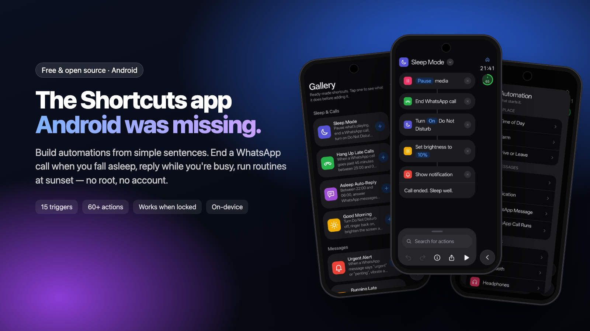
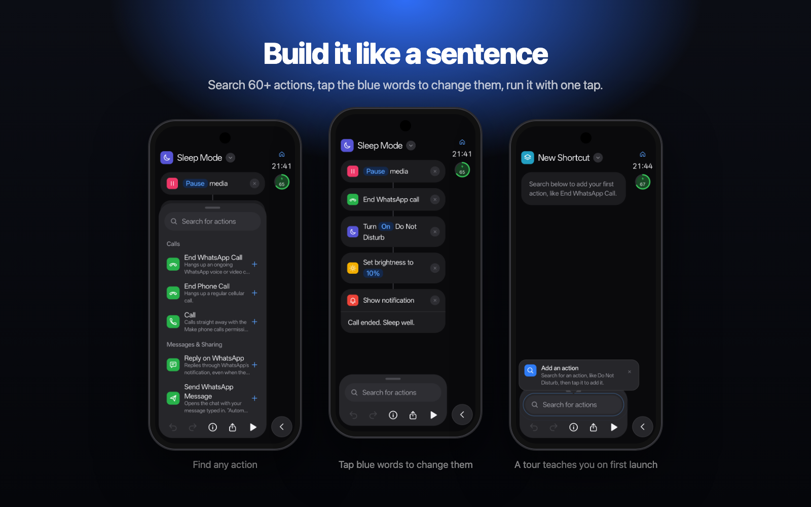
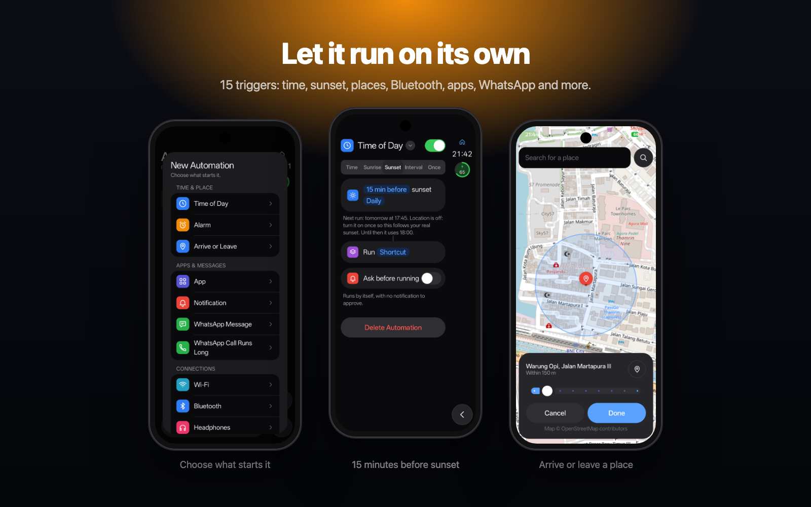
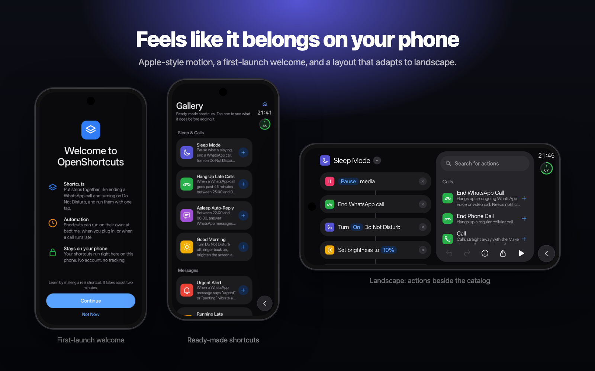

<h1 align="center">OpenShortcuts</h1>

<p align="center"><b>The Shortcuts app Android was missing.</b><br>
Free, open-source automation for Android, inspired by iOS Shortcuts: build routines from simple sentences, run them with one tap, or let them run on their own.</p>

<p align="center">
  <a href="#install"></a>
  
  
  
</p>

<p align="center"></p>

It started with one problem: falling asleep on a WhatsApp call and waking up to a hot phone and an empty battery. OpenShortcuts ends that call for you, with the screen off and the phone locked, and then does whatever else you like: Do Not Disturb, dim the screen, lock the phone.

## Why OpenShortcuts

- **Reads like a sentence.** “Turn **On** Do Not Disturb”, “Set brightness to **10%**”, “Send WhatsApp to **Mama**”. Tap a blue word to change it. No flowcharts, no scripting language.
- **Runs on its own.** 15 triggers, from time of day and sunset to arriving home, a Bluetooth car kit or a WhatsApp message. No notification to approve.
- **Works when your phone is locked.** Ending a WhatsApp call and replying to a chat go through WhatsApp's own notification buttons, so they work with the screen off.
- **Private.** No account, no tracking, no ads. Everything runs on the phone.
- **Feels native.** Apple-style motion and controls, haptics, dark mode, a tour on first launch, and a layout that fits tall phones, landscape and small cover screens.

<p align="center"></p>

## Automations: 15 triggers

| Group | Triggers |
|---|---|
| Time & place | **Time of day** (daily, weekly, monthly, once, every 15 min–12 h within hours you choose), **Sunrise / Sunset** with an offset, **Alarm** goes off or is stopped, **Arrive at / Leave a place** picked on a map with a radius |
| Apps & messages | **App** opened or closed, **Notification** from any app containing some words, **WhatsApp message** from a chat or contact, **WhatsApp call runs long** |
| Connections | **Wi-Fi**, **Bluetooth** device (chosen from your paired devices), **Headphones**, **Airplane Mode** |
| Power & focus | **Charger**, **Battery level**, **Battery Saver**, **Do Not Disturb** |

Each automation shows exactly when it runs next. Switch the trigger of an existing automation without starting over. Turn on **Ask before running** for any automation that should give you a minute to snooze or skip.

<p align="center"></p>

## 60+ actions

- **Calls & WhatsApp**: end a WhatsApp call, end a phone call, reply to a WhatsApp chat, send a WhatsApp message to a contact, call, send SMS, email, share
- **Device**: Do Not Disturb, ringer, volume, brightness, flashlight, media play/pause, vibrate, lock screen, speak text, battery level
- **Clock & calendar**: timer, alarm, add an event, read upcoming events
- **Location**: current location, show in Maps
- **Scripting**: If / Otherwise, Repeat, Repeat with Each, Choose from Menu or List, Ask for Input, variables, Wait, Run Shortcut, Stop
- **Text & data**: replace, split, combine, match, change case, extract links, numbers, emails or phone numbers, lists, dictionaries, calculate, dates and date math

Pick contacts, apps, times and dates from real pickers: a contact list with WhatsApp marks, iOS-style time wheels, day chips. Use `{Shortcut Input}`, `{Current Time}`, `{Message Sender}` or your own variables in any text.

## Run them from anywhere

- Tap a tile, or **hold its … button** to delete (with Undo)
- A **Home Screen icon** per shortcut and a **Quick Settings tile**
- The app icon's long-press menu and launcher search
- **Share sheet** and the text-selection menu, with the shared text as input
- **Describe a shortcut** in a sentence, in English or Indonesian, and Claude builds it for you to review (optional, bring your own API key)
- A **Gallery** of 12 ready-made shortcuts: Sleep Mode, Hang Up Late Calls, Asleep Auto-Reply, Urgent Alert, Pomodoro, Low Battery Saver…
- Share any shortcut as an `.openshortcut` file; whoever opens it sees every action before adding it

## Designed like a phone's own app

<p align="center"></p>

The layout borrows from folded “iPhone Duo” cover-screen concepts: a rail with the clock and a battery ring you can tap, white sentence cards with blue tokens, and a floating bottom sheet. Screens slide like iOS navigation, and the system back gesture follows your finger. Swipe an action or automation away to delete it. A short tour on first launch teaches the app by building a real shortcut.

## How it works when the phone is locked

| Action | Locked phone |
|---|---|
| End a WhatsApp call | Works. Presses **Hang up** on WhatsApp's call notification |
| Reply on WhatsApp | Works. Uses the **Reply** box on WhatsApp's message notification |
| Send WhatsApp to a contact | If that person has a WhatsApp notification, it replies right from the lock screen. Otherwise the message waits and **sends by itself the moment you unlock** |
| Settings actions (Do Not Disturb, ringer, brightness, lock…) | Work |

No app can open a WhatsApp chat behind a PIN-locked screen; this is the closest Android allows, and it needs no root.

## Install

Download the latest APK from **[Releases](../../releases)**, or build it yourself:

```bash
./gradlew :app:assembleDebug
```

```bash
adb install -r app/build/outputs/apk/debug/app-debug.apk
```

Requirements to build: JDK 17 and the Android SDK (compileSdk 37). Runs on Android 10 and later.

After installing, open **Setup** (the sliders button) and allow what your shortcuts use. On Xiaomi, Oppo, Vivo and Samsung phones, also allow **Autostart / background activity**, otherwise the phone may stop automations at night.

## Permissions

Everything is optional and asked for only when a shortcut needs it.

| Permission | Used for |
|---|---|
| Notification access | Seeing WhatsApp's call and message notifications, the Notification and Alarm triggers |
| Notifications | What an automation did, and the optional “Ask before running” notice |
| Alarms & reminders | Running time-based automations on the exact minute |
| Unrestricted battery | Keeping night automations alive |
| Usage access | The App trigger (which app is on screen) |
| Nearby devices | The Bluetooth trigger |
| Location, Location all the time | Sunrise/sunset times, Get Location, and the Arrive/Leave trigger |
| Contacts | Picking a person for Call, SMS, Email and WhatsApp |
| Do Not Disturb, Modify system settings, Phone calls, Make calls, Send SMS, Calendar | Only for the actions that use them |
| Accessibility (two optional services) | Lock Screen, and pressing Send in WhatsApp. The WhatsApp service can only see WhatsApp |

## Privacy

No account, no analytics, no ads. Shortcuts are stored as JSON in the app's private storage. The network is used only for map tiles (OpenStreetMap) when you pick a place, and for *Describe a shortcut* if you add your own Claude API key, in which case only your sentence and your shortcut names are sent.

## Build and test

```
app/src/main/java/app/openshortcuts/
  model/    actions, shortcuts, automations, JSON store
  engine/   runner, triggers, WhatsApp call watcher, alarms, geofences, permissions
  ui/       Compose screens, motion and design tokens
fakewa/     a fake WhatsApp for emulator tests
```

`fakewa/` posts WhatsApp-style call and message notifications so you can test hang-up and the WhatsApp triggers on an **emulator** without a second phone:

```bash
./gradlew :fakewa:assembleDebug
```

```bash
adb -s emulator-5554 install -r fakewa/build/outputs/apk/debug/fakewa-debug.apk
```

```bash
adb -s emulator-5554 shell am start -n com.whatsapp/dev.test.fakewa.CallActivity --es mode ongoing
```

## Roadmap

- NFC tag trigger
- Wi-Fi by network name
- Signed release builds on GitHub and F-Droid

Ideas and bug reports are welcome in [Issues](../../issues). If OpenShortcuts saves your battery tonight, a ⭐ helps others find it.

---

Kotlin and Jetpack Compose. Tested on an Oppo Find X8 (Android 17) and Android emulators. Not affiliated with Apple or WhatsApp.
