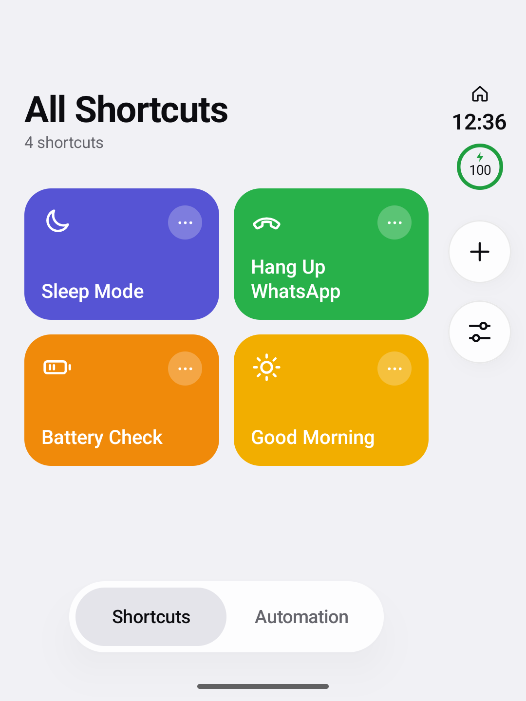
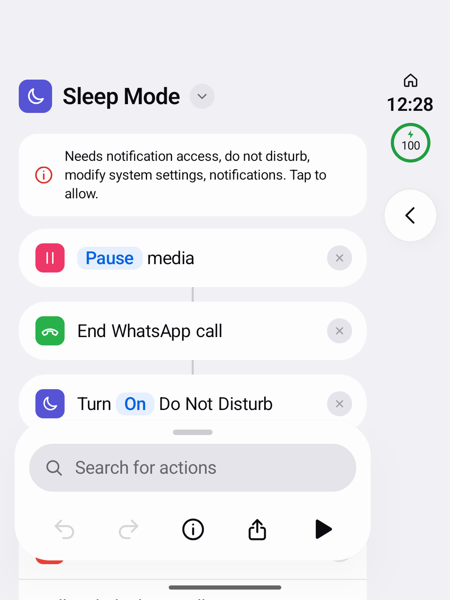
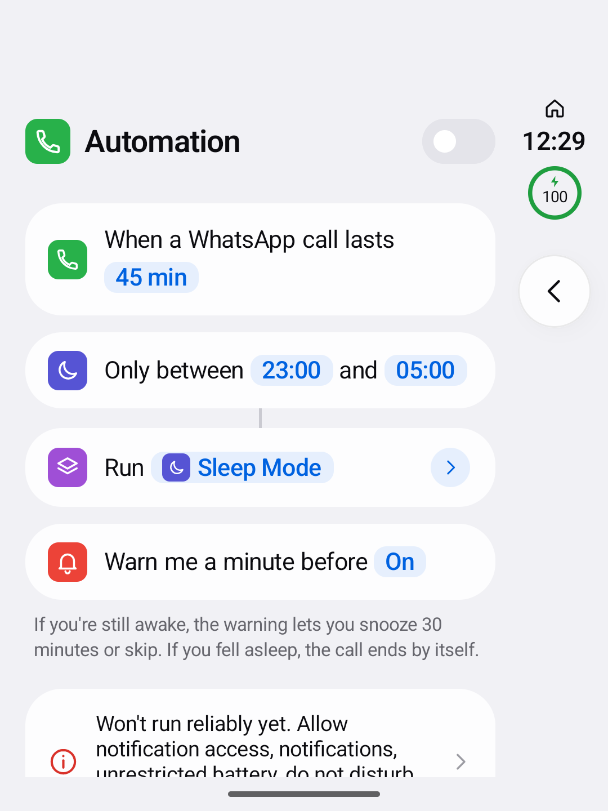
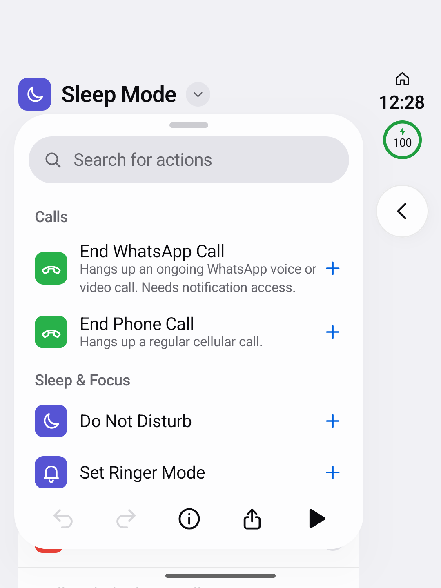
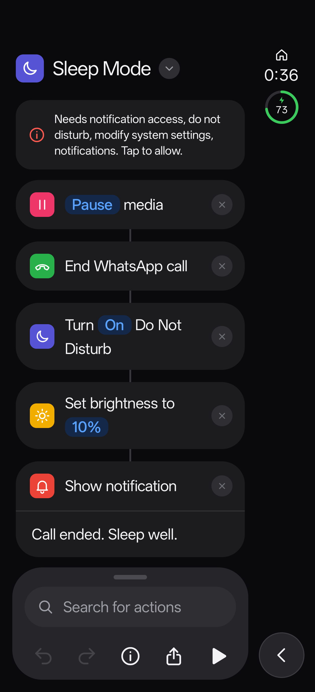
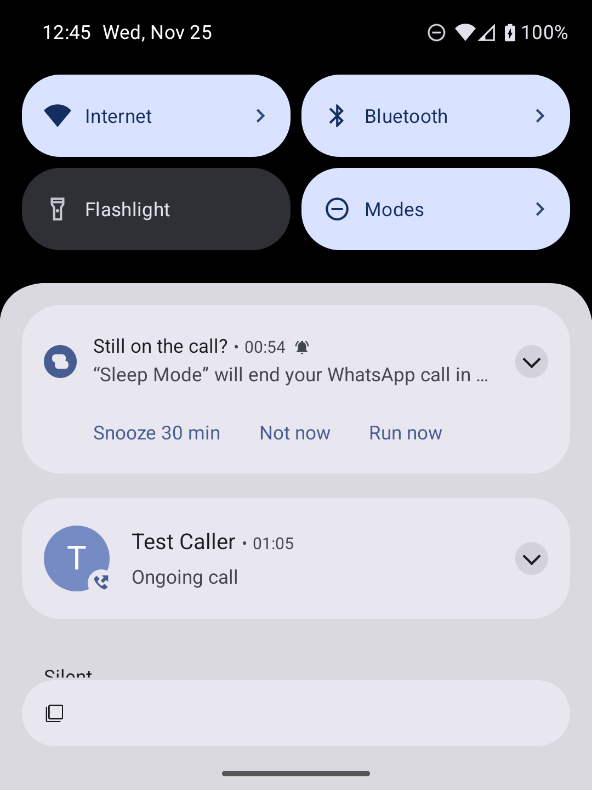

# OpenShortcuts

Shortcuts-style automation for Android. Build routines out of small actions, run them with one tap, or let them run on their own: at a time of day, or when a WhatsApp call goes on too long.

It started with one problem: falling asleep on a WhatsApp call and waking up to a hot phone and a dead battery. OpenShortcuts can end that call for you, after a one-minute warning you can snooze.

<p>
  
  
  
</p>

## What it does

- **Shortcuts as sentences.** Every action reads like a sentence with blue tokens you tap to change: “Turn **On** Do Not Disturb”, “Set brightness to **10%**”.
- **Scripting**: If / Otherwise, Repeat, Choose from Menu, Ask for Input, Set / Get Variable, Wait, Run Shortcut. Put `{Current Time}`, `{Shortcut Input}` or your own `{Variable}` in any text.
- **Automations**
  - *Time of day*: daily, weekdays, or any days you pick.
  - *WhatsApp call runs long*: “when a call lasts 45 min, only between 23:00 and 05:00”.
  - *WhatsApp message* (from anyone, or a contact or group you name), *Charger*, *Battery level*, *Do Not Disturb*, *Wi-Fi*.
  - Optional one-minute warning with **Snooze 30 min / Not now / Run now**, so it never hangs up on you while you're awake.
- **27 actions**: end a WhatsApp call, end a phone call, lock the screen, speak text, Do Not Disturb, ringer mode, pause/play media, volume, brightness, flashlight, vibrate, battery level, open app, open URL, text, notifications and more.
- **Run from anywhere**: a Home Screen icon per shortcut, a Quick Settings tile, and the app icon's long-press menu (also shown in launcher search).
- **Share shortcuts as files**: Share sends a `.openshortcut` file. Whoever opens it sees every action, and a warning for things like ending calls, before tapping Add Shortcut.
- Search for actions in English or Indonesian (“tutup telepon”, “tidur”).
- Light and dark mode, follows your system text size.

## Design

The layout borrows from the folded “iPhone Duo” cover-screen concepts: a right-hand rail with the clock, a battery ring and round controls, white sentence cards, and a floating bottom sheet for search and the toolbar. On tall phones the rail controls move to the bottom so they stay under your thumb.

<p>
  
  
  
</p>

## How ending a WhatsApp call works

WhatsApp shows an ongoing-call notification with its own **Hang up** button. OpenShortcuts listens to notifications (with your permission) and presses that button for you. That means:

- no root, no accessibility service, works with the screen off;
- a call that is still **ringing** is never touched, only connected calls;
- button labels are matched in several languages (Hang up, End call, Akhiri, Tutup, …).

It only reads WhatsApp's call notification. Nothing leaves your phone; the app has no internet permission.

## Permissions

Open **Setup** (the sliders button) and allow what your shortcuts use:

| Permission | Used for |
|---|---|
| Notification access | Seeing WhatsApp's call and pressing Hang up |
| Notifications | Results and the one-minute warning |
| Do Not Disturb | Do Not Disturb and silent ringer |
| Modify system settings | Brightness |
| Phone calls | Ending regular cellular calls |
| Alarms & reminders | Running automations on the exact minute |
| Unrestricted battery | Keeping night automations alive |
| Accessibility (optional) | The Lock Screen action only. The service listens to no events and can't read the screen |

On Xiaomi, Oppo, Vivo and Samsung phones, also turn on **Autostart / background activity** for OpenShortcuts in the phone's own settings.

## Build

Requirements: JDK 17 and the Android SDK (compileSdk 37).

```bash
./gradlew :app:assembleDebug
```

```bash
adb install -r app/build/outputs/apk/debug/app-debug.apk
```

Kotlin, Jetpack Compose, no third-party dependencies. Shortcuts are stored as JSON in the app's private storage.

### Testing call hang-up without a second phone

`fakewa/` is a test-only app with the package name `com.whatsapp`. It posts a fake call notification so you can test hang-up and the “call runs long” automation on an **emulator**. Android refuses to install it on a phone that already has the real WhatsApp.

```bash
./gradlew :fakewa:assembleDebug
```

```bash
adb -s emulator-5554 install -r fakewa/build/outputs/apk/debug/fakewa-debug.apk
```

```bash
adb -s emulator-5554 shell am start -n com.whatsapp/dev.test.fakewa.CallActivity --es mode ongoing
```

Modes: `ongoing`, `legacy` (button labelled “Tutup”), `incoming` (must not be hung up), `clear`.

## Project layout

```
app/src/main/java/app/openshortcuts/
  model/    actions, shortcuts, automations, JSON store
  engine/   runner, WhatsApp call watcher, alarms, notifications, permissions
  ui/       Compose screens and the design tokens
fakewa/     fake WhatsApp for emulator tests
```

## Status

Early. Tested on an Android 16 emulator and an Oppo Find X8 (Android 17). Hanging up the real WhatsApp has been verified against WhatsApp-style notifications in the emulator; if it fails on your phone, please open an issue with your WhatsApp language.

Not affiliated with Apple or WhatsApp.
